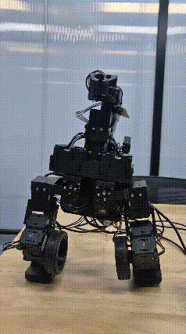
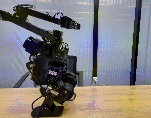
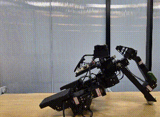

# ShiftOstrich

**보행과 차륜 주행, 물체 조작을 하나의 플랫폼에서 연구하는 소형 로봇**

ShiftOstrich는 이족보행 하체에 바퀴와 매니퓰레이터를 결합한 교육·연구용 로봇입니다. 다리를 접거나 펴서 이동 자세를 바꾸고, 로봇의 설계·제작부터 시뮬레이션과 실물 제어까지 연결하는 것을 목표로 개발하고 있습니다.

이 저장소는 **ROS 2 로봇 모델, Gazebo 실행 환경, 하드웨어 브릿지, 준비 자세·변신 동작, 팔 텔레옵, 학습 정책 실행기**를 제공합니다.

## 동작 영상

### 실물 보행 실험

<p align="center">
  
</p>

### 보행 자세 ↔ 차륜 주행 자세

| 변신 | 역변신 |
|:---:|:---:|
|  |  |

## 주요 특징

- **이족보행과 차륜 주행** — 다리와 바퀴를 활용한 이동 및 자세 전환을 연구합니다.
- **매니퓰레이터와 그리퍼** — 이동과 함께 물체를 잡고 조작하는 작업을 연구하며, OpenRB 리더암을 이용한 팔 텔레옵을 제공합니다.
- **시뮬레이션과 Sim-to-Real** — MuJoCo 기반 보행 학습과 실물 적용을 연구합니다. 이 저장소에는 URDF·메시와 Gazebo 실행 환경, 실물 제어 코드를 포함합니다.
- **3D 프린팅 기반 제작** — 구조를 직접 수정하고 출력하며 설계·조립·시험을 반복합니다.

## 하드웨어

| 항목 | 구성 |
|---|---|
| 하체 | 다리당 5자유도, 총 10자유도 |
| 이동 방식 | 이족보행 및 차륜 주행 |
| 조작부 | 매니퓰레이터 및 그리퍼 |
| 액추에이터 | ROBOTIS DYNAMIXEL |
| 제어 보드 | OpenCR, OpenRB 리더암 연동 |
| 구조물 | 3D 프린팅 부품 중심 |
| 로봇 높이 | 약 330 mm |
| 로봇 질량 | 약 1.6 kg |

치수와 구성은 설계 버전에 따라 달라질 수 있습니다.

## 설치

Ubuntu 24.04 · ROS 2 Jazzy · Gazebo Harmonic 환경을 기준으로 합니다. ROS 2와 Gazebo를 설치한 뒤, 이 저장소를 작업 공간의 `src/shift_ostrich`에 배치합니다.

```bash
cd ~/biped_bike_ws
source /opt/ros/jazzy/setup.bash
rosdep install --from-paths src --ignore-src -r -y
colcon build --packages-select shift_ostrich
source install/setup.bash
```

다른 터미널에서도 명령을 실행하기 전에 다음 환경을 불러옵니다.

```bash
source /opt/ros/jazzy/setup.bash
source ~/biped_bike_ws/install/setup.bash
```

## Gazebo에서 실행

터미널 1에서 시뮬레이터를 시작합니다.

```bash
ros2 launch shift_ostrich gazebo.launch.py
```

터미널 2에서 준비 자세(READY), 변신, 역변신을 실행합니다. **각 동작이 끝난 뒤 다음 명령을 입력합니다.**

```bash
# 준비 자세
ros2 run shift_ostrich ready_posture.py

# READY → 차륜 주행 자세 (약 20초)
ros2 run shift_ostrich transform.py

# 차륜 주행 자세 → READY (약 20초)
ros2 run shift_ostrich revert.py
```

저장된 동작은 [config/motions](config/motions)에 있습니다.

## 실물에서 실행

### 하드웨어 연결과 준비 자세

먼저 [config/hardware.yaml](config/hardware.yaml)의 포트·모터 ID·영점·회전 방향·위치 제한을 실제 조립 상태에 맞춥니다. 기본 포트 `/dev/opencr`은 장치 별칭이므로, 별칭이 없다면 실제 `/dev/serial/by-id/...` 경로로 수정합니다. 관절 매핑은 실제 로봇에서 확인해야 합니다.

OpenCR에는 DYNAMIXEL 통신과 IMU 피드백을 지원하는 [브릿지 펌웨어](arduino/opencr_dxl_bridge_with_imu/opencr_dxl_bridge_with_imu.ino)가 필요합니다. Wizard 등 같은 포트를 사용하는 프로그램은 종료합니다.

**다음 명령은 모터 토크를 켭니다. 로봇을 지지한 상태에서 실행합니다.**

```bash
# 터미널 1: 하드웨어 브릿지와 RViz
ros2 launch shift_ostrich ch_policy_hardware.launch.py
```

```bash
# 터미널 2: 연결 확인 후 준비 자세
ros2 run shift_ostrich ready_posture.py
```

브릿지가 실행 중이면 위의 `transform.py`와 `revert.py` 명령도 사용할 수 있습니다. 이 브릿지는 보행·자세 제어용으로 바퀴를 수동 상태로 유지합니다.

### 팔 텔레옵

OpenRB 리더암을 연결하고 [config/teleop.yaml](config/teleop.yaml)의 포트와 매핑을 맞춥니다. 실물 브릿지는 별도 터미널에서 실행해 둡니다.

```bash
# 목표 자세 미리보기
ros2 launch shift_ostrich teleop.launch.py preview_only:=true
```

미리보기를 종료한 뒤 실제 팔 추종을 시작합니다.

```bash
ros2 launch shift_ostrich teleop.launch.py \
  preview_only:=false enable_on_start:=true
```

현재 기본 설정에서는 팔로워 그리퍼 추종을 비활성화해 두었습니다.

### 학습 정책 실행

정책 실행에는 **별도의 학습된 정책 파일**이 필요합니다. 현재 실행기는 J146 정책의 입력 270개·출력 10개 및 관절·관측 계약을 검사합니다. 다른 형식이나 학습 설정의 모델은 실행기 호환성을 확인해야 합니다.

```bash
# 정책 파일 검사: 모터 명령을 보내지 않음
ros2 run shift_ostrich j146_policy.py \
  --policy /path/to/policy.npz --check-only

# 하드웨어 브릿지 연결 후: 정책용 READY → 정착 → 보행 20초
ros2 run shift_ostrich j146_policy.py \
  --policy /path/to/policy.npz \
  --arm --ready-time 4 --ready-settle-time 1 \
  --start-after-ready --duration 20
```

정책 실행기는 학습에 사용한 READY를 직접 준비하며, 일반 `ready_posture.py`의 자세와 다릅니다. 실물 보행은 실험 단계이므로 로봇을 지지하고 짧은 시험부터 확인합니다.

PyTorch 체크포인트는 `--policy` 대신 `--checkpoint-file /path/to/model.pt`로 지정합니다. 변환에는 해당 정책과 일치하는 MJLab 프로젝트와 `uv`가 필요합니다. MJLab 경로 기본값은 `~/mjlab`이며 `--mjlab-root`로 변경할 수 있습니다. 변환된 `.npz`는 ROS Python과 NumPy로 실행합니다.

## 저장소 구성

| 경로 | 내용 |
|---|---|
| [scripts](scripts) | READY·변신·역변신·팔 텔레옵·브릿지·IMU·정책 실행 명령 |
| [core](core) | 공통 제어 코드, 동작 실행, 충돌 검사, 정책 추론 |
| [launch](launch), [config](config) | ROS 실행 설정, 하드웨어 매핑, 저장 동작 |
| [urdf](urdf), [meshes](meshes), [worlds](worlds) | 로봇 모델과 Gazebo 자산 |
| [arduino](arduino) | OpenCR 펌웨어 |
| [fusion_360_export](fusion_360_export) | Fusion에서 내보낸 모델 자료 |
| [media](media) | 실물 동작 GIF |

## 보행 연구 및 학습 환경

낮은 교대 보행, 강화학습 기반 안정화, 시뮬레이션과 실물의 응답 차이 보정을 연구하고 있습니다. MJLab 기반 학습 환경은 보행 개발이 완료된 뒤 별도 저장소로 공개할 예정입니다.
